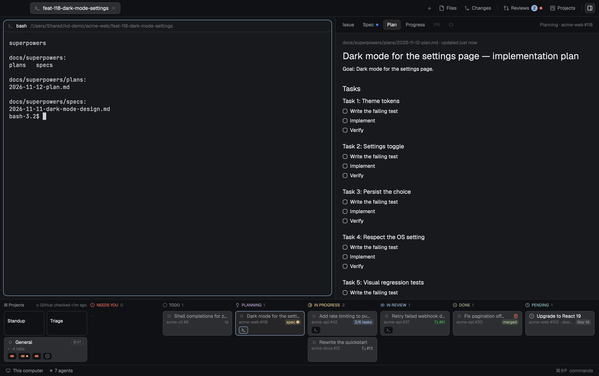

# Kanban Drawer

A Herdr window built around a kanban board that lives in a drawer along the bottom. Each
git worktree you work in is a card that moves through TODO → Planning → In progress →
Pending → In review → Done, and each card shows its Claude sessions live as they work.
A "Needs you" column on the left of the board lists every agent that is blocked or has
finished unseen. Beside the terminal, a Stage column follows the space you are in. It
shows the card's issue, spec, plan, task progress, pull request and post-merge CI, and
lets you merge, approve or request changes without leaving the window. A right panel
toggles between Files, Changes, Reviews (team PRs waiting on you) and Projects (your
org's GitHub Projects by phase).



## What you see

Top to bottom, left to right. The spaces sidebar exists but starts hidden (`cmd-b` shows it).

- **Tab bar, 42px, full width** (`strip-tabs`). It sits in the window's title bar, with no
  native title bar and the macOS traffic lights at `[12, 16]`. Background is `chrome`, with
  a 1px `border` line below.
  - Tabs are pills 29px tall, 7px radius, 12.8px text. The active tab is `raised` with a
    `border` outline and a close ×. Inactive tabs are flat `chrome` with `muted` text.
  - Each tab shows its program icon (14px) and a live label: a named tab keeps its name;
    otherwise Claude's session title, a shell's folder name, or the program name, cut at
    220px. A working tab shows a spinner, and a blocked or done tab a 6px dot.
  - Right of the tabs, in order: `+` (new menu); **Files** and **Changes**; a 1×16px
    divider; **Reviews** with a count badge; **Projects**. Next comes an amber deploy-gate
    badge (only while a gate waits), another divider, and a 26px Stage toggle at the far
    right.
- **Work row**, between the tab bar and the drawer, with 1px `border` dividers:
  - **Terminal area**, weight 56, min 360px, padding 8. It shows the active tab's panes as
    cards: 10px radius, 1px `border`, `accent` border when focused, 8px gaps. Each card has
    a 30px header drawn by Herdr's shipped `pane` mod, always visible, even for a lone pane.
    Terminal padding is `[14, 12]`.
  - **Stage column**, weight 44, min 320, max 1400 (`stage`). It has its own 42px sub-tab
    header level with the tab bar: Issue · Spec · Plan · Progress · PR · CI, showing only
    the tabs the card has. Below the header is the body for the chosen tab.
  - **Right panel**, 368px (280–900), hidden by default. It is a stack of Herdr's shipped
    `files` and `changes`, plus `reviews` and `projects`.
- **Board drawer**, 166px by default (`board-strip`). Background is `chrome`, with a 1px
  `border` line on top and padding 5 top, 8 bottom, 10 sides.
  - **Left column**, 210px. The header row has `▤ Projects` with its key cap and
    `↻ GitHub checked 2m ago`, which turns red with an error count when a check fails.
    Below it are the seats from `seats.json`. Seats with a one-click command are
    buttons, two to a row, each 62px tall. Other seats are cards like a board card.
  - **Columns**, sharing the rest of the width with 8px gaps: **Needs you**, **TODO**,
    **Planning**, **In progress**, **In review**, **Done**, **Pending**. **Team reviews**
    and **Other agents** appear only when they have rows. Every stage column always
    shows, so nothing jumps sideways. A column header is 10px uppercase in the stage's
    color, with a lucide icon and a count:
    - Needs you: `blocked`, circle-alert.
    - TODO: `muted`, circle-dashed.
    - Planning: `ansi5`, lightbulb.
    - In progress: `ansi3`, contrast.
    - Pending: `ansi6`, clock.
    - In review: `ansi4`, eye.
    - Done: `ansi2`, circle-check.

    Narrower than 96px, a column collapses to a 64px count with its list in a tooltip.
  - **A card** is 62px tall, 7px radius, `raised`, and has three lines:
    1. Status icon and title, 12px.
    2. `repo #issue`, a `+N repo` badge when the issue spans other repos' worktrees, and a
       right-hand chip, 10.5px `dim`.
    3. A row of tab chips: one per tab in the card's space, with that tab's program icons
       and status dot. Chips that don't fit become `+k`.

    The card of the space you are in gets an `accent` border and a `selected` background.
- **Status bar**, 28px (Herdr's shipped `workspace-status`).

PR badges use GitHub's dark colors: open `#3fb950`, merged `#a371f7`, closed or blocked
`#f85149`, draft `muted`. CI colors in the Stage column: success `#3fb950`, failure
`#f85149`, running/gate `#d29922`, queued/neutral `#8b949e`.

## How it behaves

**Agent status**, wherever an agent shows (card line 1, seats, Needs you, tabs):

- working: a spinning 12px spinner in `working`.
- blocked: a 14px `!` square, `blocked` on a 15% tint.
- done (finished, unseen): a solid 7px dot in `done`.
- idle: a hollow 7px ring.
- none: a faint ring.

A card's dot is the most urgent of every agent in its worktree, its child worktrees, or its
space (blocked > done > working > idle).

**Needs you** lists agents, not cards. It lists every blocked agent, then every finished
agent you have not looked at. A finished agent on a Done card is not listed. Each row is
half a card tall (31px), outlined in the color of the column its card sits in, with the
owner (`repo #n · title`, a seat's name) in `dim`. Click focuses that pane. The card stays
in its own column.

**Card chips** (line 2, right):

- Planning: `Spec new` / `Plan new` when a spec or plan changed since you last opened it
  in the Stage column.
- In progress: `3/7` task progress from the plan and its ledger.
- Pending: the check-back date, or `Due today` / `Overdue · Nov 3` in `blocked`.
- Done: `CI running` / `CI failed` for the post-merge runs, or `merged`.
- Otherwise: one PR badge per PR (icon + `#123`, colored by state, CI and review), or the
  card's age (`3h`).

**Card clicks.**

- Click a card to focus its lead agent, or open a space at the worktree.
- Click a tab chip to select that tab.
- Click a PR badge to open the PR in the card's own space (a `pr` tab).
- Hovering a card shows an issue icon, which opens the issue (an `issue-q` tab).
- Right-click opens a menu: Move to (any other stage), Pending… / Snooze… / Resume,
  Open issue, and Remove worktree… in `blocked`.
- Done cards also show a trash icon that opens Herdr's Remove worktree dialog. That
  closes every terminal that ran there and drops the card once the folder is gone.

**Pending** opens a 400×300 dialog that asks what the card waits on and when to check
back (`+1d`, `+3d`, `+1w` or a date). A Pending card that reaches its date toasts once and
sorts to the top of its column.

**The drawer's height snaps** to whole cards 300ms after a drag ends: 2 cards minimum,
166px. At 5 cards or more it becomes a lane grid, with one row per repo and the stage
columns lined up under one header. Clicking a card there opens it and drops the drawer
back to its last short height. `cmd-j` hides and shows the drawer.

**GitHub sync.** Every 3 minutes, and on `↻`, the drawer runs `herdr-board sync` and
`herdr-board reviews`. Cards move on GitHub transitions only:

- PR opened → In review.
- Changes requested or PR closed unmerged → In progress.
- PR merged or issue closed → Done.

Each move toasts `repo #n → Stage`. A Claude Code hook moves cards as you work:

- First code edit → In progress. Edits under `docs/plans/`, `docs/specs/`,
  `docs/superpowers/`, `docs/memory/` and `.claude/` don't count.
- `gh pr create` → In review.
- `git push` on an In-progress card with an open PR → In review.
- `gh pr merge` → Done.

Moves also set Status on the issue's GitHub Project items (Todo, In Progress, In Review,
Done). Done cards leave the board after 2 days.

**Seats** are fixed places for work that is not a card. Each comes from `seats.json`
and owns a space by name.

- A button seat: click to type its command into the seat's Claude session, or start one
  with it as the first message. When that session waits on an answer, the click focuses it
  and toasts. Right-click goes to the seat's space.
- A card seat: click to go to its space. Its key (`cmd-shift-t` for `board-strip.scratch`)
  opens a new tab there.

**Stage column.** It follows the active space and shows nothing for seats.

- **Default tab by stage:**
  - TODO: Issue.
  - Planning: Plan, then Spec, then Issue.
  - In progress: Progress.
  - In review: PR.
  - Done: CI.
  - Pending: Progress, then Plan, then Issue.

  A tab you pick by hand holds until the card's stage changes.
- **Issue**: the issue in Markdown. When the space has no Claude session, a bar offers
  **Start session**. It opens Claude with the orient-and-plan prompt and moves a TODO
  card to Planning.
- **Spec / Plan**: the newest `docs/superpowers/specs|plans/*.md` in the worktree, rendered,
  with a picker when there are several. Opening one marks it seen.
- **Progress**: the plan's `### Task N:` list, checked off from the ledger at
  `.superpowers/sdd/*/progress.md`.
- **PR**: header, checks, and the diff. The actions are Comment, Request changes, Approve,
  and Merge with a method menu and a Delete branch option. They gate on CI and review.
  When the only failing check is a `semver` check, it offers **Add semver label**.
  **Trace** colors each added line by the Claude Code turn that wrote it (`herdr-blame`).
  **Code review** opens a review space for the PR (`herdr-review`).
- **CI**: the post-merge runs on the base branch, with any deploy gate waiting on approval.
  **Remove worktree…** sits at the bottom.
- `cmd-shift-\` or the tab-bar toggle hides and shows the column. The toggle is greyed
  out where the space has no card or review.

**Right panel** (`cmd-alt-b` toggles it; `cmd-alt-p` cycles the views):

- **Reviews**: open, non-draft PRs that request you or your team, or that a teammate opened
  and you have not reviewed. Each row shows avatar, repo #n, CI, size and why it is listed,
  with bots grouped apart. New PRs toast and play the blocked sound. The tab-bar badge is
  solid with a red dot while any are unseen. Click a row to open the PR in its review space
  or a shared "Reviews" space.
- **Projects** (`cmd-k`): one collapsed block per open org Project. It shows the current
  phase, phase bars by status, open items with assignees, and what blocks them. A flat
  list is used for projects without phases. An issue opens as an `issue-q` tab with
  **Queue** (assign to you, worktree, card, start Claude) and **Park** (same, no session).
  Each takes two clicks: the first arms it for 6s.
- **Deploy gates**: the tab bar polls the org every 2 minutes for workflow runs waiting on an
  environment's reviewers. It shows an amber badge with a count, and toasts new ones.

## Built from

Layout `layouts/kanbandrawer.json`:

```
root (row, background canvas, titlebar none, traffic_lights [12,16], terminal_padding [14,12])
├─ sidebar (column, 268px, hidden, chrome): workspace-chrome 46px · spaces · workspace-chrome {footer:true} 69px
└─ work (column)
   ├─ tabs: block strip-tabs, 42px, window_drag
   ├─ work-body (row, divider 1px border)
   │  ├─ work-main (column, weight 56, min 360) › main-wrap (row, padding 8)
   │  │    › main: { tab: "active", pane: { header: { mod: "pane", reveal: "always", height: 30 },
   │  │             radius 10, gap 8, border 1 border, focus 1 accent, lone: true } }
   │  ├─ stage: block stage, weight 44, min 320, max 1400
   │  └─ panel (column, 368px, 280–900, hidden) › panel-body (stack, active "files"):
   │       files (shipped) · changes (shipped) · reviews · projects
   ├─ strip: block board-strip, 166px, min 166
   └─ status: block workspace-status, 28px
```

Mods in `mods/`:

- `board-strip`: the drawer. It is also its own overlays, picked by props: `{menu: true, …}`
  (card menu, popup 230 wide) and `{pendingDialog: true, …}` (dialog 400×300). `logic.js`
  holds the geometry and column rules and `stage-logic.js` the doc and ledger parsing; both
  are pure. Commands: `board-strip.projects`, `board-strip.reviews`, and any seat's
  `action` / `command.action`.
- `stage`: the Stage column, with `issue-view.js` and `pr-view.js` as nested entities. It
  publishes shared `stage.available` and owns `stage.seen`, `stage.tab` and
  `stage.manualHidden`.
- `strip-tabs`: a clone of Herdr's `tabs`. Commands are `strip-tabs.stage-toggle` and
  `strip-tabs.panel-next`. It publishes shared `ci.gates` and reads `reviews.seen` and
  `workspace.panels`.
- `reviews`, `projects`: the panel views.
- `pr`: a PR as a tab, plus the popup menus (merge method, labels) that `stage` opens with
  `openOverlay({mod: "pr", props: {menu}})`.
- `issue-q`: an issue as a tab with Queue / Park.

Shipped mods it uses: `workspace-chrome`, `spaces`, `pane`, `files`, `changes`,
`workspace-status`, `menu`, `new-menu`, `worktree` (the Remove worktree dialog), and icons
from `mods/workspace-chrome/`, `mods/pane/`, `mods/files/`, `mods/changes/`.

`herdr` functions: `agents`, `panes`, `spaces`, `terminals`, `layout`, `keys`, `theme`,
`window`, `settings`, `shared`/`setShared`, `watchFolder`, `readTextFile`, `exec`, `hc`,
`notify`, `playSound`, `setAgentOrder`, `openOverlay`/`closeOverlay`, `nextCommand`.

App commands: `layout.resize|show|hide|toggle|select`, `space.new|select|close`,
`tab.new|select|close|move|rename`, `pane.focus|close`.

Programs it runs, all in `support/bin/`, installed to `~/.claude/herdr/bin/`:

- `herdr-board` (Python 3, standard library): the only writer of
  `~/.claude/herdr/board.json`. Its subcommands are `add`, `set`, `pending`, `snooze`,
  `resume`, `pr`, `rm`, `list`, `show`, `sync`, `reviews` (writes `reviews.json` and caches
  avatars into `mods/reviews/avatars/`), `projects` (writes `projects.json`), `push-status`,
  and `hook` (the Claude Code PostToolUse hook).
- `herdr-q <repo> <issue> [--park] --yes`: assigns the issue, adds a worktree at
  `~/.herdr/worktrees/<repo>/<type>-<n>-<slug>` on `<type>/<n>-<slug>`, runs setup, adds the
  card, and opens a space.
- `herdr-review <owner/repo> <n>`: checks the PR out to `~/.herdr/worktrees/<repo>/pr-<n>`
  and opens a `Review <repo> #<n>` space running the review command.
- `herdr-blame <owner/repo> <n> --json`: maps a PR's added lines to Claude Code transcript
  turns.

They also need `gh` (logged in), `git`, `jq`, and `claude`.

Config in `~/.claude/herdr/` (examples in `support/`):

- `config.json`:
  - `org`: default owner, and the org for Reviews, Projects and gates.
  - `review_team`: team slug.
  - `clones`: folders holding your clones.
  - `setup`: setup command per repo name.
  - `review_command`: the review command.
- `seats.json`: `{seats: [{name, space, folder, argv?, action?, command?: {send | run, label, action}}]}`.

Keys (`keys.json`, section `layout:kanbandrawer`):

- `cmd-k` Projects.
- `cmd-shift-t` scratch seat.
- `cmd-shift-\` Stage.
- `cmd-alt-b` panel.
- `cmd-j` drawer.
- `cmd-alt-p` next panel view.

Art: lucide icons, 24×24 SVG with `currentColor` strokes and tinted by the theme. PR
glyphs are in `mods/board-strip/icons/` and `mods/stage/icons/`; the tab-bar glyphs are
in `mods/strip-tabs/`.

## Watch out

- **Nothing moves without the hook.** Add `herdr-board hook` to `~/.claude/settings.json`
  as a `PostToolUse` hook on `Edit|Write|NotebookEdit|Bash`. Without it, cards change only
  on GitHub transitions and by hand.
- **Cards come from `herdr-q` or `herdr-board add`.** A worktree made any other way has no
  card. Only linked worktrees qualify; a repo's main checkout never gets a card.
- **Mods cannot import across folders.** `closeWorktreeTabs`, the plan and ledger parsing,
  and the PR view are copied between `board-strip`, `stage` and `pr` on purpose. Fix all
  copies together.
- **`<mod>.<command>` reaches shown copies only.** The drawer must be in the layout for
  the seat keys to work, even while it is hidden.
- **Images must live under the app home.** That is why `herdr-board reviews` writes
  avatars into `mods/reviews/avatars/`. The folder starts empty.
- **Spec, Plan and Progress follow one convention:** `docs/superpowers/specs|plans/` and
  `.superpowers/sdd/*/{plan-path,progress.md}`, as written by the superpowers Claude Code
  plugin. Other layouts of docs show no Spec, Plan or Progress tabs.
- **`exec("open", …)` is macOS.** Links open with `open`; on another OS swap in the
  platform's opener.
- **Reviews, Projects and gates need `org`.** Without it, Reviews and Projects report an
  error and the gate badge never shows. Projects is a set of expensive GraphQL reads. It is
  cached per project and re-read at most every 6 hours unless it changed, and it backs off
  on rate limits.
- **The status push writes to GitHub.** Moving a card sets Status on every open Project
  item of its issue. Set `HERDR_BOARD_PUSH=off` to stop that.
- **Name clashes.** If you already have mods named `stage`, `pr`, `reviews` or `projects`,
  rename these, along with their `mods/<name>/` paths and every `mod:` that names them.
- The sidebar's spaces list is there but hidden. The layout is meant to be driven from
  the drawer.

## Done when

- `herdr-app check` passes for each of the seven mods, and `layout.switch
  {"name":"kanbandrawer"}` shows the tab bar, the terminal, the Stage column and the drawer
  with no `layout.error`.
- `herdr-board add --path <a linked worktree> --repo o/r --issue 1 --title Test --stage
  claimed` puts a card in TODO within a second. `herdr-board set <path> --stage
  in_progress` moves it.
- Starting Claude in that worktree's space puts its status on the card. A permission
  prompt adds a row to Needs you; clicking the row focuses that pane.
- Dragging the drawer taller snaps to whole cards. At 5 cards or more it becomes repo
  lanes, and `cmd-j` hides it.
- Selecting the card's space shows the Stage column on the stage's default tab. A PR URL
  added with `herdr-board pr --url …` shows a PR badge, and the PR tab loads the diff.
- `↻` runs a sync and updates `GitHub checked … ago`. With `org` set, Reviews and Projects
  fill in.
- Right-click on a card → Pending… → `+1d` moves it to Pending with the date chip.
