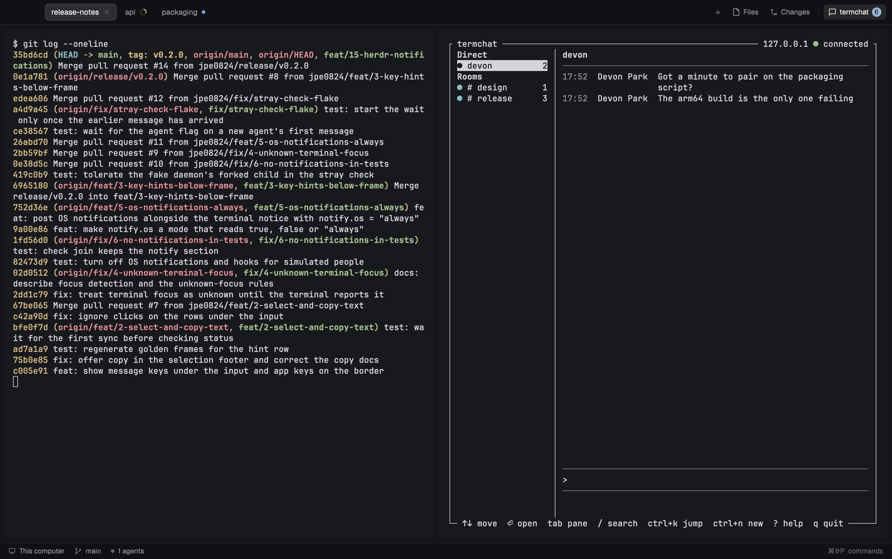

# Herdr + Termchat

Herdr's default layout with [termchat](https://github.com/jpe0824/termchat) in the right
panel. A **termchat** button in the tab bar shows how many messages are unread and opens a
live termchat session beside your terminals. Herdr's own alerts, including termchat's, also
reach macOS as system notifications while the Herdr window is in the background.



## What you see

Herdr's shipped `main` layout, unchanged except for:

- **Tab bar** (`termchat-tabs`): after **Files** and **Changes**, a 1×16px divider and a
  **termchat** button (lucide `message-square`). When anything is unread, an `accent` badge
  shows the total across all conversations (`99+` above 99).
- **Right panel**: a third view, `termchat`, after `files` and `changes`. It shows the kept
  terminal named `termchat`, which runs the termchat interface.
- **Notifications** (`system-toast`): Herdr's toast, plus a macOS notification when the toast
  opens while the Herdr window is not the active app.

## How it behaves

- **Unread count**: polled every 5 s from `termchat chats --json`. A conversation open in the
  panel's termchat counts as read once the interface marks it read, so the badge counts the
  other conversations.
- **Opening termchat**: the button starts the terminal when none is live
  (`hc run --bg --keep --no-notify --name termchat`), then shows the panel. The terminal is
  started from the app, so it has no parent agent and outlives any session.
- **Quitting termchat** (`ctrl+c`) leaves the terminal at "termchat closed. Press enter to
  open it again." Herdr closes a pane whose program exits and removes its block from the
  layout, so the terminal runs termchat in a loop. If the block is gone anyway, the button
  puts it back.
- **Panel widths**: each panel view keeps its own width. The width the panel has when you
  leave a view (another view, or the panel closed) is saved for that view in shared
  `panel.widths` and restored next time. termchat starts at half the window; the others at
  the layout's 368px.
- **macOS notifications**: `system-toast` posts with `osascript`, so macOS lists them under
  Script Editor; allow it in System Settings → Notifications. It fires for every Herdr alert
  (an agent needs you, an agent finished while you weren't looking) and every `notify()`.
  Herdr raises those for programs that report status with OSC 7501, which termchat does not
  do yet; until it does, termchat's own `notify.os` setting posts its notifications.

## Installing

Needs `termchat` with an account (`termchat join`) and `hc` on the login shell's `PATH`.

1. Copy `layouts/termchat.json` to `~/.config/herdr-app/layouts/` and each folder in `mods/`
   to `~/.config/herdr-app/mods/`. Rename on a name clash.
2. `herdr-app do layout.switch --name termchat`.

## Built from

Layout `layouts/termchat.json`: Herdr's `main` layout with these changes.

```
root: "toast": "system-toast"
└─ work
   ├─ tabs: termchat-tabs (was tabs)
   └─ work-body
      └─ panel (column, 368px, hidden)
         └─ panel-body (stack): files · changes · termchat { "terminal": "termchat" }
```

Mods:

- `termchat-tabs`: Herdr's shipped `tabs`, plus `termchat.js` (button, unread polling,
  terminal and block upkeep) and `panelwidth.js` (per-view widths).
- `system-toast`: Herdr's shipped `toast`, plus the macOS notification. Title and body reach
  `osascript` only as arguments, never inside the script text.

## Watch out

- **A program exiting deletes its block.** Herdr closes a pane whose program exits and
  removes that block from the layout, panel blocks included. Run termchat in a loop in the
  terminal, and re-add the block (`layout.set`) when it is missing.
- **Start the terminal from the app, not from an agent's terminal.** `hc run` inside an agent's
  terminal records that agent as the parent; the new terminal then dies with it
  (`die_with_parent`) and sends it notes. The mod's `exec("hc", ...)` has no parent.
- **Blocks resolve terminals by name.** `{ "terminal": "termchat" }` follows whichever live
  terminal holds that name, so a restarted terminal shows in the same place.
- **The conversation open in the panel stays read.** termchat marks the open conversation read
  even while the panel is hidden, so it never counts toward the badge (tracked in
  jpe0824/termchat#15).
- **Polling starts termchat's background process.** `termchat chats` starts it when it is not
  running, every 5 s.
- **`herdr-app check` posts a notification.** The check runs `system-toast` with the window
  inactive, so `osascript` really posts one.
- **macOS lists the notifications under Script Editor**, since `osascript` posts them.
- **Herdr alerts come only from OSC 7501.** OSC 9, 99 and 777 make an in-app notice at most;
  none reached macOS while the window was in the background.
